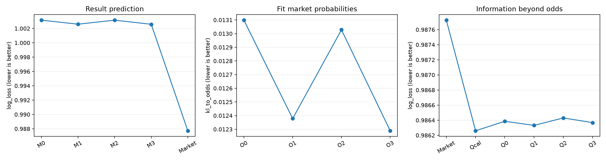

# 第一版基线结果

近期固定5场，历史交锋使用此前全部记录，不使用时间衰减。模型是L2多分类逻辑回归；按比赛等权评价。模型输入清单见model_inputs.csv。

## 样本与划分

| split | matches | first_date | last_date | divisions |
| --- | --- | --- | --- | --- |
| train | 106288 | 2000-09-05 00:00:00 | 2020-12-31 00:00:00 | 29 |
| validation | 12598 | 2021-01-01 00:00:00 | 2022-12-31 00:00:00 | 29 |
| test | 11772 | 2023-01-01 00:00:00 | 2024-12-30 00:00:00 | 29 |
| excluded_after_2024 | 2854 | 2025-01-01 00:00:00 | 2025-06-01 00:00:00 | 19 |

特征历史来自230,554场有效赛果；预测样本来自cleaned.csv。2025不参与拟合或评分。最终训练使用截至2022年的118,886场，模型固定预测2023—2024的11,772场。测试期间历史随已经发生的比赛更新。2023—2024曾在早先分析中查看，本轮不是完全未接触过的独立验证。

## 赛果预测

M0=B，M1=B+近期五场，M2=B+全部交锋，M3=B+两者。B含联赛、Elo差、交锋数量和无交锋标记。Market是原始归一化赔率。

| model | matches | log_loss | brier | accuracy |
| --- | --- | --- | --- | --- |
| M0 | 11772 | 1.003156 | 0.599690 | 0.502718 |
| M1 | 11772 | 1.002596 | 0.599286 | 0.501189 |
| M2 | 11772 | 1.003159 | 0.599688 | 0.503313 |
| M3 | 11772 | 1.002583 | 0.599273 | 0.501954 |
| Market | 11772 | 0.987725 | 0.589294 | 0.519878 |

准确率为0到1的比例；Brier为三类平方误差之和。Log Loss和Brier越小越好。

M1相对M2：平均损失更低，差值-0.000563，95%区间[-0.001235, 0.000096]；区间跨0，不能说差异稳定。

M1相对M0：平均损失更低，差值-0.000560，95%区间[-0.001269, 0.000103]；区间跨0，不能说差异稳定。

M2相对M0：平均损失更高，差值0.000003，95%区间[-0.000345, 0.000328]；区间跨0，不能说差异稳定。

M3相对M1：平均损失更低，差值-0.000013，95%区间[-0.000380, 0.000327]；区间跨0，不能说差异稳定。

M3相对M2：平均损失更低，差值-0.000576，95%区间[-0.001292, 0.000086]；区间跨0，不能说差异稳定。

## 哪组信息更接近赔率

O0—O3的输入分别与M0—M3一致，但目标改为赔率隐含概率；不把赔率输入自身拟合模型。KL越小，预测分布越接近赔率。

| model | matches | kl_to_odds | odds_probability_mae |
| --- | --- | --- | --- |
| O0 | 11772 | 0.013099 | 0.038584 |
| O1 | 11772 | 0.012378 | 0.037852 |
| O2 | 11772 | 0.013028 | 0.038467 |
| O3 | 11772 | 0.012289 | 0.037713 |

O1相对O2：平均损失更低，差值-0.000650，95%区间[-0.000819, -0.000501]；该项描述性区间未跨0。

这是与赔率的统计关系，不能推出博彩公司实际采用的算法。

## 赔率之外是否还有帮助

Qcal仅校准赔率；Q0=Q+B，Q1=Q+B+F，Q2=Q+B+H，Q3=Q+B+F+H。历史增益与Q0比较。

| model | log_loss | brier | accuracy |
| --- | --- | --- | --- |
| Qcal | 0.986260 | 0.588522 | 0.519368 |
| Q0 | 0.986386 | 0.588625 | 0.519793 |
| Q1 | 0.986331 | 0.588588 | 0.519793 |
| Q2 | 0.986430 | 0.588644 | 0.520133 |
| Q3 | 0.986368 | 0.588601 | 0.519963 |
| Market | 0.987725 | 0.589294 | 0.519878 |

Q1相对Q0：平均损失更低，差值-0.000054，95%区间[-0.000391, 0.000260]；区间跨0，不能说差异稳定。

Q2相对Q0：平均损失更高，差值0.000045，95%区间[-0.000045, 0.000130]；区间跨0，不能说差异稳定。

Q3相对Q0：平均损失更低，差值-0.000018，95%区间[-0.000393, 0.000308]；区间跨0，不能说差异稳定。

## 描述性相关

| feature | odds_target | spearman_rho |
| --- | --- | --- |
| recent_ppg_diff | home_minus_away | 0.569201 |
| recent_gd_diff | home_minus_away | 0.611694 |
| h2h_ppg_diff | home_minus_away | 0.529509 |
| h2h_gd | home_minus_away | 0.566906 |
| recent_draw_rate_mean | draw_probability | 0.153916 |
| h2h_draw_rate | draw_probability | 0.183077 |

相关性没有控制所有混杂因素，不证明因果关系。完整年份结果见test_scores_by_year.csv，验证选择见validation_scores.csv与selection.json。

## 范围与限制

- 结论针对当前Elo完整、五场历史完整、赔率有效的筛选样本；历史记录只覆盖文件内赛事。
- Elo包含用户允许的较早历史补值，不能认为所有评分都代表最新实力。
- 交锋优势可能仍反映实力差异，不能仅据此认定战术克制。
- 28天时间块bootstrap重复1000次，按测试年分别抽样。区间是逐项描述性区间，不含重新训练／选择不确定性，没有多重比较的同时保证。
- 没有投注收益回测，预测或拟合改善不等于盈利。

