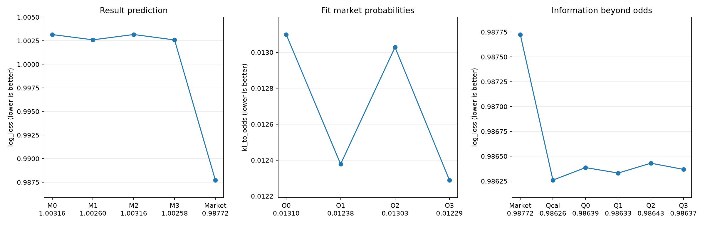

# Baseline

**原题。** For a given matchup between teams, what is more useful to predict results: most recent form, or historical form between the teams. How does this correlate with the betting odds for a given match?

对一场给定对阵，预测赛果时更有用的是各队近 5 场，还是两队此前的全部交锋？这两块信息和该场赔率如何相关？

## 对原题的回答

**赛果。** 近期状态和历史交锋对赛果都没有稳定的额外影响。近 5 场（M1）的 Log Loss 是 1.002596，全部交锋（M2）是 1.003159，差值 -0.000563，95% 区间 [-0.001235, 0.000096] 包含 0。直接使用赔率的 Market 是 0.987725，对赛果的影响大于这两块信息彼此的差别。

**赔率。** 近期状态比历史交锋更接近盘口。拟合赔率时，近 5 场（O1）的 KL 比全部交锋（O2）低 0.000650，95% 区间 [-0.000819, -0.000501] 不包含 0。近 5 场净胜球与 \(q_H-q_A\) 的 Spearman 系数是 0.612，交锋净胜球是 0.567。已知赔率后再加入近 5 场或交锋，赛果 Log Loss 没有稳定下降。

## 样本

| split | matches | first_date | last_date | divisions |
| --- | --- | --- | --- | --- |
| train | 106288 | 2000-01-01 | 2020-12-31 | 22 |
| validation | 12598 | 2021-01-01 | 2022-12-31 | 22 |
| test | 11772 | 2023-01-01 | 2024-12-31 | 22 |
| excluded_after_2024 | 11075 | 2025-01-01 | 2026-05-10 | 22 |

历史来自 238,854 场有效赛果，预测样本来自 cleaned.csv。最终拟合使用截至 2022 年末的 118,886 场，评价 2023—2024 的 11,772 场。2025 及以后不拟合、不评分。

## 哪一块更能预测赛果

M0 只用基础信息 B（联赛、Elo 差、交锋场数、有无交锋）。M1 加入近 5 场，M2 加入全部交锋，M3 两块都加。Market 不训练，直接使用归一化赔率概率。Log Loss 和 Brier 越小越好。

| model | matches | log_loss | brier | accuracy |
| --- | --- | --- | --- | --- |
| M0 | 11772 | 1.003156 | 0.603760 | 0.474261 |
| M1 | 11772 | 1.002596 | 0.603382 | 0.474686 |
| M2 | 11772 | 1.003159 | 0.603763 | 0.474176 |
| M3 | 11772 | 1.002583 | 0.603372 | 0.474771 |
| Market | 11772 | 0.987725 | 0.592719 | 0.487343 |

M1 相对 M0 的平均 Log Loss 更低，差值 -0.000560，95% 区间 [-0.001269, 0.000103]；区间包含 0，不能认为差异稳定。

M2 相对 M0 的平均 Log Loss 更高，差值 0.000003，95% 区间 [-0.000345, 0.000328]；区间包含 0，不能认为差异稳定。

M1 相对 M2 的平均 Log Loss 更低，差值 -0.000563，95% 区间 [-0.001235, 0.000096]；区间包含 0，不能认为差异稳定。

M3 相对 M1 的平均 Log Loss 更低，差值 -0.000013，95% 区间 [-0.000380, 0.000327]；区间包含 0，不能认为差异稳定。

M3 相对 M2 的平均 Log Loss 更低，差值 -0.000576，95% 区间 [-0.001292, 0.000086]；区间包含 0，不能认为差异稳定。

Market 的 Log Loss 比最好的 M 模型低 0.014858。这个差距大于上面 M 模型彼此之间的差值。

## 哪一块更接近赔率

O0–O3 的输入与 M0–M3 相同，训练目标改为赔率概率，输入中不含赔率。KL 越小，预测分布越接近赔率。

| model | matches | kl_to_odds | odds_probability_mae |
| --- | --- | --- | --- |
| O0 | 11772 | 0.013099 | 0.040132 |
| O1 | 11772 | 0.012378 | 0.039480 |
| O2 | 11772 | 0.013028 | 0.040116 |
| O3 | 11772 | 0.012289 | 0.039409 |

O1 相对 O2 的平均 KL 更低，差值 -0.000650，95% 区间 [-0.000819, -0.000501]；描述性区间不包含 0。

这是统计上的贴近，不能说明博彩公司实际使用了这些变量。

测试集 Spearman 相关如下。方向性特征对照 \(q_H-q_A\)，平局比例对照 \(q_D\)。相关没有控制 Elo 和联赛。

| feature | odds_target | spearman_rho |
| --- | --- | --- |
| recent_ppg_diff | q_H-q_A | 0.569 |
| recent_gd_diff | q_H-q_A | 0.612 |
| recent_draw_rate_mean | q_D | 0.154 |
| h2h_ppg_diff | q_H-q_A | 0.530 |
| h2h_gd | q_H-q_A | 0.567 |
| h2h_draw_rate | q_D | 0.183 |

## 已知赔率之后是否还有增量

Qcal 只用赔率对数比预测赛果。Q0 在赔率上加入 B，Q1 再加入近 5 场，Q2 再加入交锋，Q3 两块都加。

| model | log_loss | brier | accuracy |
| --- | --- | --- | --- |
| Market | 0.987725 | 0.592719 | 0.487343 |
| Qcal | 0.986260 | 0.591956 | 0.490061 |
| Q0 | 0.986386 | 0.592005 | 0.490061 |
| Q1 | 0.986331 | 0.591957 | 0.490231 |
| Q2 | 0.986430 | 0.592027 | 0.490061 |
| Q3 | 0.986368 | 0.591974 | 0.489977 |

Q1 相对 Q0 的平均 Log Loss 更低，差值 -0.000054，95% 区间 [-0.000391, 0.000260]；区间包含 0，不能认为差异稳定。

Q2 相对 Q0 的平均 Log Loss 更高，差值 0.000045，95% 区间 [-0.000045, 0.000130]；区间包含 0，不能认为差异稳定。

Q3 相对 Q0 的平均 Log Loss 更低，差值 -0.000018，95% 区间 [-0.000393, 0.000308]；区间包含 0，不能认为差异稳定。

把原始赔率做一次校准，就能得到这组里的主要下降；近 5 场和交锋没有再把损失稳定压低。

## 图与限制

三张图都使用连续纵轴，数值写在类别名下方。左图是赛果 Log Loss，中图是赔率 KL，右图是已知赔率后的赛果 Log Loss。

- 样本限于 Elo、近 5 场和赔率都完整的比赛，历史只覆盖文件内的赛事。
- 近 5 场等权、交锋使用此前全部场次，结论不能直接推广到时间衰减或 LSTM。
- 28 天块 bootstrap 重复 1000 次并按测试年分层。区间不含重新训练和选择 C 的不确定性。
- 预测损失下降不是投注收益。
