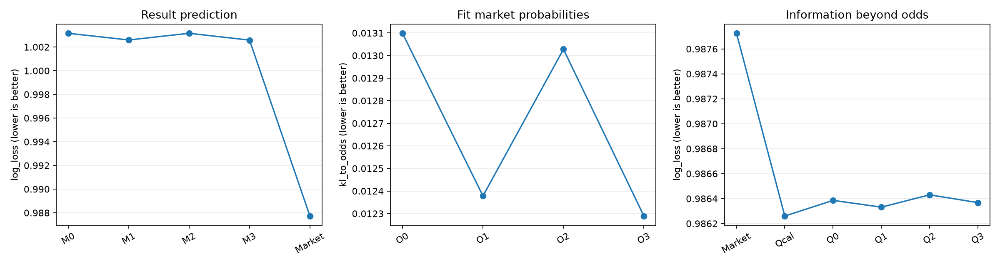
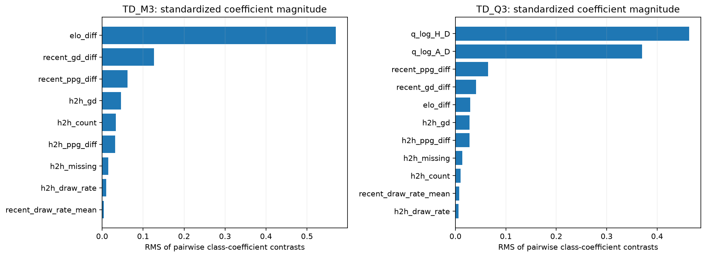
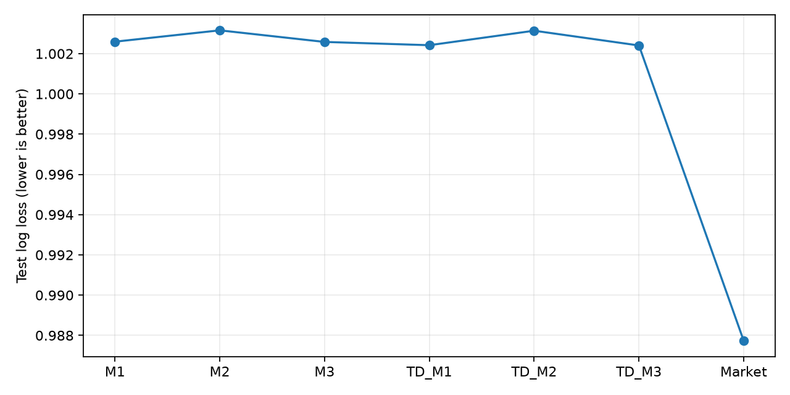
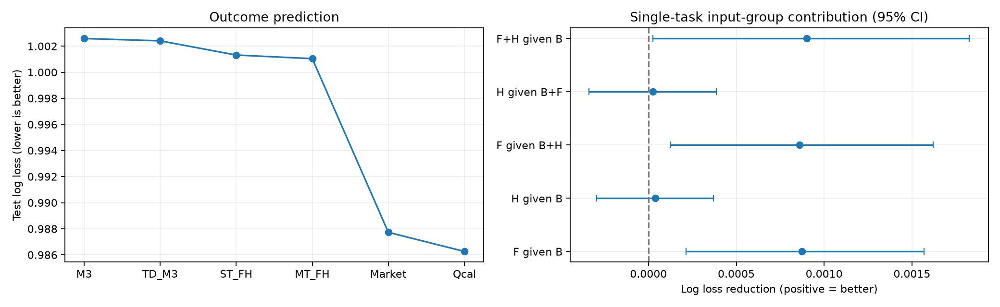

# 足球比赛分析：运行结果

<!-- data:start -->
## 共同数据与处理规则

只使用项目中的 Matches.csv 和 EloRatings.csv，日期按文件记录使用。已有 Elo 保留；缺失时按国家和球队查找严格早于比赛日的最近评分，不限制间隔，仍缺失则删除。

| stage | matches |
| --- | --- |
| raw | 238858 |
| valid_history | 238854 |
| both_elo | 145903 |
| complete_last_5 | 143733 |
| valid_odds_cleaned | 141733 |

| split | matches | first_date | last_date | divisions |
| --- | --- | --- | --- | --- |
| train | 106288 | 2000-09-05 00:00:00 | 2020-12-31 00:00:00 | 29 |
| validation | 12598 | 2021-01-01 00:00:00 | 2022-12-31 00:00:00 | 29 |
| test | 11772 | 2023-01-01 00:00:00 | 2024-12-30 00:00:00 | 29 |
| excluded_after_2024 | 11075 | 2025-01-01 00:00:00 | 2026-09-03 00:00:00 | 22 |

近期固定最近五场，不区分主客场；交锋包含此前全部直接交锋。计算历史时使用全部有效赛果，包括没有 Elo 或赔率、未进入 cleaned 的比赛。同一天先生成特征，再更新赛果。三项普通赔率均须有限且大于 1。

原始 Form 列重算；半场列只保存在 cleaned 中，不进入模型。cleaned 为比赛表，baseline_features 为模型公共特征表；history_sequences 为未拟合的逐场历史缓存。

模型先在截至 2020 年的数据拟合，2021—2022 年选择参数，再在截至 2022 年的数据最终拟合，评价 2023—2024 年。2025 年及以后保留但不参与当前拟合和评分。数值标准化仅在当前拟合集学习。

这些测试年已在此前分析中查看；以下为后续比较。样本要求 Elo、完整近五场和有效赔率，结论不能推广到全部原始比赛。原有 Elo 和赔率的独立记录时间没有另行验证。
<!-- data:end -->

<!-- baseline:start -->
## 1. Baseline：等权统计＋逻辑回归

B 为联赛、Elo 差、交锋次数和缺失标记。M0=B；M1=B+近期五场统计；M2=B+全部交锋成绩统计；M3=B+两者。H 的贡献指交锋成绩，交锋次数已经包含在所有 B 对照中。

| model | matches | log_loss | brier | accuracy |
| --- | --- | --- | --- | --- |
| M0 | 11772 | 1.003156 | 0.599690 | 0.502718 |
| M1 | 11772 | 1.002596 | 0.599286 | 0.501189 |
| M2 | 11772 | 1.003159 | 0.599688 | 0.503313 |
| M3 | 11772 | 1.002583 | 0.599273 | 0.501954 |
| Market | 11772 | 0.987725 | 0.589294 | 0.519878 |

M1、M2 的赛果损失差及 95% 区间：

| left | right | metric | difference | ci_low | ci_high | ci_includes_zero |
| --- | --- | --- | --- | --- | --- | --- |
| M1 | M0 | log_loss | -0.000560 | -0.001269 | 0.000103 | True |
| M2 | M0 | log_loss | 0.000003 | -0.000345 | 0.000328 | True |
| M1 | M2 | log_loss | -0.000563 | -0.001235 | 0.000096 | True |
| M3 | M1 | log_loss | -0.000013 | -0.000380 | 0.000327 | True |

近期的点估计优于交锋，但上述主要赛果比较区间跨 0，当前逻辑回归证据不足以认定稳定胜出。

### M 模型与市场概率

| model | matches | kl_to_odds | odds_probability_mae |
| --- | --- | --- | --- |
| M0 | 11772 | 0.014592 | 0.040264 |
| M1 | 11772 | 0.014058 | 0.039691 |
| M2 | 11772 | 0.014529 | 0.040164 |
| M3 | 11772 | 0.013968 | 0.039571 |

| left | right | metric | difference | ci_low | ci_high | ci_includes_zero |
| --- | --- | --- | --- | --- | --- | --- |
| M1 | M2 | kl_to_odds | -0.000470 | -0.000570 | -0.000380 | False |
| M1 | M0 | kl_to_odds | -0.000534 | -0.000644 | -0.000432 | False |
| M2 | M0 | kl_to_odds | -0.000064 | -0.000122 | -0.000004 | False |
| M3 | M1 | kl_to_odds | -0.000091 | -0.000148 | -0.000032 | False |
| M3 | M2 | kl_to_odds | -0.000561 | -0.000671 | -0.000460 | False |

M1 比 M2 更接近市场：KL 和 MAE 更低，配对 KL 区间不跨 0；每个类别的 Pearson/Spearman 点估计也更高。这不等于 M1 对真实赛果一定稳定更好。

| model | class | pearson | spearman |
| --- | --- | --- | --- |
| M0 | H | 0.907528 | 0.882294 |
| M0 | D | 0.815902 | 0.720077 |
| M0 | A | 0.904347 | 0.876896 |
| M1 | H | 0.912218 | 0.888591 |
| M1 | D | 0.819825 | 0.724133 |
| M1 | A | 0.909315 | 0.883315 |
| M2 | H | 0.908061 | 0.882751 |
| M2 | D | 0.816493 | 0.719577 |
| M2 | A | 0.904806 | 0.877163 |
| M3 | H | 0.912960 | 0.889362 |
| M3 | D | 0.820534 | 0.723745 |
| M3 | A | 0.909947 | 0.883799 |

### O 拟合市场、Q 检验赔率后的增益

| model | kl_to_odds | odds_probability_mae |
| --- | --- | --- |
| O0 | 0.013099 | 0.038584 |
| O1 | 0.012378 | 0.037852 |
| O2 | 0.013028 | 0.038467 |
| O3 | 0.012289 | 0.037713 |

| left | right | metric | difference | ci_low | ci_high | ci_includes_zero |
| --- | --- | --- | --- | --- | --- | --- |
| O1 | O2 | kl_to_odds | -0.000650 | -0.000819 | -0.000501 | False |

O1 的赔率 KL 也低于 O2。Qcal 只使用赔率对数比；Q0 再加 B，Q1/Q2/Q3 分别加 F/H/F+H。

| model | log_loss | brier | accuracy |
| --- | --- | --- | --- |
| Market | 0.987725 | 0.589294 | 0.519878 |
| Qcal | 0.986260 | 0.588522 | 0.519368 |
| Q0 | 0.986386 | 0.588625 | 0.519793 |
| Q1 | 0.986331 | 0.588588 | 0.519793 |
| Q2 | 0.986430 | 0.588644 | 0.520133 |
| Q3 | 0.986368 | 0.588601 | 0.519963 |

| left | right | metric | difference | ci_low | ci_high | ci_includes_zero |
| --- | --- | --- | --- | --- | --- | --- |
| Q1 | Q0 | log_loss | -0.000054 | -0.000391 | 0.000260 | True |
| Q2 | Q0 | log_loss | 0.000045 | -0.000045 | 0.000130 | True |
| Q3 | Q0 | log_loss | -0.000018 | -0.000393 | 0.000308 | True |

已知赔率后加入近期或交锋，当前区间没有显示稳定的额外赛果预测改善。

### 系数与相关性

| feature | beta_H | beta_D | beta_A | ratio_H_A_per_SD |
| --- | --- | --- | --- | --- |
| elo_diff | 0.402354 | -0.005693 | -0.396662 | 2.223352 |
| h2h_count | -0.017007 | -0.010732 | 0.027739 | 0.956240 |
| h2h_missing | 0.004179 | 0.006763 | -0.010942 | 1.015236 |
| recent_ppg_diff | -0.048264 | 0.007155 | 0.041110 | 0.914504 |
| recent_gd_diff | 0.093733 | -0.014036 | -0.079698 | 1.189378 |
| recent_draw_rate_mean | 0.000896 | 0.003273 | -0.004169 | 1.005077 |
| h2h_ppg_diff | -0.018489 | 0.016336 | 0.002153 | 0.979570 |
| h2h_gd | 0.043753 | -0.021516 | -0.022237 | 1.068215 |
| h2h_draw_rate | -0.002262 | 0.005747 | -0.003485 | 1.001223 |

数值输入已标准化。ratio_H_A_per_SD 为增加一个标准差时主胜/客胜概率比的倍数，其他输入固定；不是重要性或主胜概率百分比。积分差与净胜球差相关，系数需合并解释。

| feature | odds_target | spearman |
| --- | --- | --- |
| recent_ppg_diff | q_H-q_A | 0.569058 |
| recent_gd_diff | q_H-q_A | 0.611679 |
| recent_draw_rate_mean | q_D | 0.154402 |
| h2h_ppg_diff | q_H-q_A | 0.529509 |
| h2h_gd | q_H-q_A | 0.566906 |
| h2h_draw_rate | q_D | 0.183077 |

<!-- baseline:end -->

<!-- time_decay:start -->
## 2. Time decay：时间加权统计＋逻辑回归

保持五场近期窗口、全部交锋、B 和模型不变，统计改用归一化时间权重。近期半衰期 90 天、交锋 365 天是预先固定设置，没有验证为最优。TD_M1/2/3 对应 B+F、B+H、B+F+H；O/Q 的目标和输入规则与 baseline 一致。

| model | matches | log_loss | brier | accuracy | kl_to_odds | odds_probability_mae |
| --- | --- | --- | --- | --- | --- | --- |
| TD_M1 | 11772 | 1.002421 | 0.599169 | 0.501104 | 0.013984 | 0.039629 |
| TD_M2 | 11772 | 1.003141 | 0.599664 | 0.504077 | 0.014585 | 0.040277 |
| TD_M3 | 11772 | 1.002407 | 0.599144 | 0.502379 | 0.013960 | 0.039631 |
| Market | 11772 | 0.987725 | 0.589294 | 0.519878 | -0.000000 | 0.000000 |

| left | right | metric | difference | ci_low | ci_high | ci_includes_zero |
| --- | --- | --- | --- | --- | --- | --- |
| TD_M1 | M1 | log_loss | -0.000175 | -0.000283 | -0.000069 | False |
| TD_M1 | M0 | log_loss | -0.000736 | -0.001516 | 0.000022 | True |
| TD_M2 | M2 | log_loss | -0.000018 | -0.000250 | 0.000253 | True |
| TD_M2 | M0 | log_loss | -0.000015 | -0.000232 | 0.000188 | True |
| TD_M3 | M3 | log_loss | -0.000176 | -0.000415 | 0.000075 | True |
| TD_M3 | M0 | log_loss | -0.000749 | -0.001638 | 0.000077 | True |
| TD_M1 | TD_M2 | log_loss | -0.000720 | -0.001470 | 0.000016 | True |
| TD_M3 | TD_M1 | log_loss | -0.000013 | -0.000226 | 0.000199 | True |
| TD_M3 | TD_M2 | log_loss | -0.000734 | -0.001523 | 0.000013 | True |

### 与市场的关系

| model | matches | kl_to_odds | odds_probability_mae |
| --- | --- | --- | --- |
| M0 | 11772 | 0.014592 | 0.040264 |
| TD_M1 | 11772 | 0.013984 | 0.039629 |
| TD_M2 | 11772 | 0.014585 | 0.040277 |
| TD_M3 | 11772 | 0.013960 | 0.039631 |

| left | right | metric | difference | ci_low | ci_high | ci_includes_zero |
| --- | --- | --- | --- | --- | --- | --- |
| TD_M1 | TD_M2 | kl_to_odds | -0.000601 | -0.000717 | -0.000486 | False |
| TD_M1 | M0 | kl_to_odds | -0.000608 | -0.000728 | -0.000490 | False |
| TD_M2 | M0 | kl_to_odds | -0.000007 | -0.000040 | 0.000032 | True |
| TD_M3 | TD_M1 | kl_to_odds | -0.000024 | -0.000056 | 0.000014 | True |
| TD_M3 | TD_M2 | kl_to_odds | -0.000626 | -0.000743 | -0.000511 | False |

TD_M1 比 TD_M2 更接近市场概率，配对 KL 区间不跨 0。加入交锋后的 TD_M3 比 TD_M1 的 KL 只略低，区间跨 0；MAE 还略高，不能称为全面改善。

| model | class | pearson | spearman |
| --- | --- | --- | --- |
| M0 | H | 0.907528 | 0.882294 |
| M0 | D | 0.815902 | 0.720077 |
| M0 | A | 0.904347 | 0.876896 |
| TD_M1 | H | 0.912789 | 0.889310 |
| TD_M1 | D | 0.819729 | 0.723820 |
| TD_M1 | A | 0.909844 | 0.884002 |
| TD_M2 | H | 0.907600 | 0.882329 |
| TD_M2 | D | 0.814985 | 0.718750 |
| TD_M2 | A | 0.904677 | 0.877149 |
| TD_M3 | H | 0.913024 | 0.889571 |
| TD_M3 | D | 0.819033 | 0.722638 |
| TD_M3 | A | 0.910280 | 0.884398 |

| feature | odds_target | spearman |
| --- | --- | --- |
| recent_ppg_diff | q_H-q_A | 0.568374 |
| recent_gd_diff | q_H-q_A | 0.611004 |
| recent_draw_rate_mean | q_D | 0.145774 |
| h2h_ppg_diff | q_H-q_A | 0.497015 |
| h2h_gd | q_H-q_A | 0.544853 |
| h2h_draw_rate | q_D | 0.128529 |

### O 拟合赔率与 Q 增量

| model | matches | log_loss | brier | accuracy | kl_to_odds | odds_probability_mae |
| --- | --- | --- | --- | --- | --- | --- |
| TD_O1 | 11772 | 1.003116 | 0.599661 | 0.503568 | 0.012317 | 0.037789 |
| TD_Q1 | 11772 | 0.986328 | 0.588593 | 0.520048 | 0.001350 | 0.012646 |
| TD_O2 | 11772 | 1.003789 | 0.600130 | 0.505182 | 0.013041 | 0.038506 |
| TD_Q2 | 11772 | 0.986383 | 0.588605 | 0.519963 | 0.001171 | 0.011731 |
| TD_O3 | 11772 | 1.003082 | 0.599638 | 0.503568 | 0.012245 | 0.037697 |
| TD_Q3 | 11772 | 0.986317 | 0.588568 | 0.519368 | 0.001382 | 0.012807 |

| left | right | metric | difference | ci_low | ci_high | ci_includes_zero |
| --- | --- | --- | --- | --- | --- | --- |
| TD_O1 | O1 | kl_to_odds | -0.000061 | -0.000109 | -0.000026 | False |
| TD_O1 | O0 | kl_to_odds | -0.000782 | -0.000939 | -0.000629 | False |
| TD_O1 | TD_O2 | kl_to_odds | -0.000724 | -0.000905 | -0.000558 | False |
| TD_Q1 | Q1 | log_loss | -0.000003 | -0.000065 | 0.000075 | True |
| TD_Q1 | Q0 | log_loss | -0.000057 | -0.000365 | 0.000255 | True |
| TD_Q2 | Q2 | log_loss | -0.000048 | -0.000155 | 0.000071 | True |
| TD_Q2 | Q0 | log_loss | -0.000003 | -0.000135 | 0.000128 | True |
| TD_Q3 | Q3 | log_loss | -0.000051 | -0.000183 | 0.000097 | True |
| TD_Q3 | Q0 | log_loss | -0.000069 | -0.000451 | 0.000318 | True |
| TD_Q1 | TD_Q2 | log_loss | -0.000054 | -0.000345 | 0.000228 | True |
| TD_Q3 | TD_Q1 | log_loss | -0.000011 | -0.000153 | 0.000124 | True |
| TD_Q3 | TD_Q2 | log_loss | -0.000066 | -0.000377 | 0.000252 | True |

时间衰减的点估计变化较小；与等权版本及已有赔率后的比较需按区间判断。预测损失降低不能解释为投资收益。

### 时间权重与模型系数

| old_to_new_position | mean_weight | equal_weight |
| --- | --- | --- |
| 1 | 0.169831 | 0.200000 |
| 2 | 0.183320 | 0.200000 |
| 3 | 0.198122 | 0.200000 |
| 4 | 0.214698 | 0.200000 |
| 5 | 0.234030 | 0.200000 |

每场先归一化，再汇总测试集；位置 1→5 为旧→新。只有一次交锋时，归一化权重仍为 1，不能据此认定久远记录可靠。时间权重不是最终预测贡献百分比。

| feature | beta_H | beta_D | beta_A | ratio_H_A_per_SD |
| --- | --- | --- | --- | --- |
| elo_diff | 0.406725 | -0.007209 | -0.399516 | 2.239474 |
| h2h_count | -0.016298 | -0.010503 | 0.026801 | 0.957817 |
| h2h_missing | 0.004963 | 0.007117 | -0.012079 | 1.017188 |
| recent_ppg_diff | -0.047425 | 0.008528 | 0.038896 | 0.917300 |
| recent_gd_diff | 0.096259 | -0.016164 | -0.080095 | 1.192861 |
| recent_draw_rate_mean | 0.000734 | 0.002715 | -0.003449 | 1.004192 |
| h2h_ppg_diff | -0.024887 | 0.018696 | 0.006190 | 0.969401 |
| h2h_gd | 0.037745 | -0.020183 | -0.017561 | 1.056864 |
| h2h_draw_rate | -0.001186 | 0.007328 | -0.006142 | 1.004968 |

系数表示标准化输入的条件关系，不能当作重要性百分比。下图分别显示 TD_M3 和含赔率的 TD_Q3，横轴是 H−D、H−A、D−A 三种系数差的均方根。输入已标准化，相关特征会分担系数；这张图不是移除特征后损失变化的排序，也不能直接作为两模型的重要性对比。

<!-- time_decay:end -->

<!-- lstm:start -->
## 3. LSTM：学习历史表示与多任务对照

近期主客各五场，共用一个 8 维 LSTM；全部交锋使用另一个 8 维 LSTM。每步为积分或积分差、净胜球、平局标记、距本场天数，按积分/3、净胜球/5、log(1+天数)/log366 转换。近期表示取主客差与均值，交锋表示取本场主队视角。拼接 B 后经 32 单元共享层，输出赛果头和赔率头。

两编码器按 90/365 天半衰期汇总隐藏状态；较新隐藏状态也可能保留较早历史，因此时间权重不是各场记录对最终预测的完整贡献。该路线同时改变序列信息保留和非线性预测层，不能把差异全部归功于 LSTM。B 组实际上是 MLP。

### 训练与输入输出

| model | base_inputs | recent_sequence | h2h_sequence | training_targets | outputs | lambda |
| --- | --- | --- | --- | --- | --- | --- |
| ST_B | Division one-hot, elo_diff, h2h_count, h2h_missing | none | none | FTResult | outcome probabilities | 0.000000 |
| MT_B | Division one-hot, elo_diff, h2h_count, h2h_missing | none | none | FTResult + q_H/q_D/q_A | outcome probabilities + odds probabilities | 0.300000 |
| ST_F | Division one-hot, elo_diff, h2h_count, h2h_missing | home+away each 5 x [points,GD,draw,age] | none | FTResult | outcome probabilities | 0.000000 |
| MT_F | Division one-hot, elo_diff, h2h_count, h2h_missing | home+away each 5 x [points,GD,draw,age] | none | FTResult + q_H/q_D/q_A | outcome probabilities + odds probabilities | 0.300000 |
| ST_H | Division one-hot, elo_diff, h2h_count, h2h_missing | none | all prior x [points difference,GD,draw,age] | FTResult | outcome probabilities | 0.000000 |
| MT_H | Division one-hot, elo_diff, h2h_count, h2h_missing | none | all prior x [points difference,GD,draw,age] | FTResult + q_H/q_D/q_A | outcome probabilities + odds probabilities | 1.000000 |
| ST_FH | Division one-hot, elo_diff, h2h_count, h2h_missing | home+away each 5 x [points,GD,draw,age] | all prior x [points difference,GD,draw,age] | FTResult | outcome probabilities | 0.000000 |
| MT_FH | Division one-hot, elo_diff, h2h_count, h2h_missing | home+away each 5 x [points,GD,draw,age] | all prior x [points difference,GD,draw,age] | FTResult + q_H/q_D/q_A | outcome probabilities + odds probabilities | 0.300000 |

ST 只优化赛果交叉熵；MT 优化 CE+λ KL(q||赔率头概率)。赔率 q 只作为训练辅助目标，不进入预测输入。各组先用一个固定 seed 在验证集按赛果 Log Loss 选择 λ 与训练轮数；最终使用三个固定 seed 分别拟合，再平均概率。

| group | lambda | epochs | validation_preferred | train_ce | train_kl | weighted_kl_fraction |
| --- | --- | --- | --- | --- | --- | --- |
| B | 0.300000 | 8 | multi | 1.010584 | 0.012306 | 0.003640 |
| F | 0.300000 | 8 | multi | 1.009883 | 0.011759 | 0.003481 |
| H | 1.000000 | 8 | multi | 1.010340 | 0.011970 | 0.011709 |
| FH | 0.300000 | 8 | multi | 1.009728 | 0.011646 | 0.003448 |

λ 是损失乘数，不是赔率信息占比；weighted_kl_fraction 仅为最后一轮训练损失的数值占比，不能解释为特征或梯度贡献。

### 赛果预测

| model | matches | log_loss | brier | accuracy | kl_to_odds | odds_probability_mae |
| --- | --- | --- | --- | --- | --- | --- |
| ST_B | 11772 | 1.002217 | 0.599221 | 0.503058 | 0.013906 | 0.039801 |
| MT_B | 11772 | 1.002026 | 0.599096 | 0.503313 | 0.013798 | 0.039664 |
| ST_F | 11772 | 1.001342 | 0.598606 | 0.503313 | 0.013194 | 0.038955 |
| MT_F | 11772 | 1.001121 | 0.598463 | 0.503738 | 0.013066 | 0.038774 |
| ST_H | 11772 | 1.002177 | 0.599181 | 0.502548 | 0.013829 | 0.039637 |
| MT_H | 11772 | 1.001935 | 0.598996 | 0.505776 | 0.013755 | 0.039661 |
| ST_FH | 11772 | 1.001317 | 0.598578 | 0.503483 | 0.013121 | 0.038846 |
| MT_FH | 11772 | 1.001042 | 0.598387 | 0.503908 | 0.013044 | 0.038738 |
| Market | 11772 | 0.987725 | 0.589294 | 0.519878 | -0.000000 | 0.000000 |

| left | right | metric | difference | ci_low | ci_high | ci_includes_zero |
| --- | --- | --- | --- | --- | --- | --- |
| MT_B | ST_B | log_loss | -0.000190 | -0.000294 | -0.000075 | False |
| MT_F | ST_F | log_loss | -0.000221 | -0.000355 | -0.000075 | False |
| MT_H | ST_H | log_loss | -0.000242 | -0.000493 | 0.000039 | True |
| MT_FH | ST_FH | log_loss | -0.000275 | -0.000439 | -0.000115 | False |
| ST_F | ST_H | log_loss | -0.000835 | -0.001542 | -0.000201 | False |
| ST_FH | ST_F | log_loss | -0.000025 | -0.000388 | 0.000338 | True |
| ST_FH | ST_H | log_loss | -0.000860 | -0.001621 | -0.000127 | False |

### 输入组贡献

| family | target | added_information | gain | ci_low | ci_high | ci_includes_zero |
| --- | --- | --- | --- | --- | --- | --- |
| ST | outcome | F given B | 0.000874 | 0.000213 | 0.001570 | False |
| ST | outcome | H given B | 0.000040 | -0.000296 | 0.000370 | True |
| ST | outcome | F given B+H | 0.000860 | 0.000127 | 0.001621 | False |
| ST | outcome | H given B+F | 0.000025 | -0.000338 | 0.000388 | True |
| ST | outcome | F+H given B | 0.000900 | 0.000025 | 0.001827 | False |
| MT | outcome | F given B | 0.000905 | 0.000232 | 0.001614 | False |
| MT | outcome | H given B | 0.000091 | -0.000382 | 0.000545 | True |
| MT | outcome | F given B+H | 0.000894 | 0.000224 | 0.001600 | False |
| MT | outcome | H given B+F | 0.000079 | -0.000336 | 0.000515 | True |
| MT | outcome | F+H given B | 0.000984 | 0.000093 | 0.001930 | False |

gain=减少输入模型损失−完整模型损失，正数表示增加信息后改善。在本次网络设置中，近期的额外预测帮助更明确；已有近期后，再加交锋成绩的区间跨 0。所有 B 中已有交锋次数和缺失标记。近期表示是差与均值共 16 维，交锋为 8 维，不能把对照解释为完全等容量的信息本质比较。MT 各组还分别选择 λ。

### 赔率头

| model | kl_to_odds | odds_probability_mae |
| --- | --- | --- |
| MT_B_odds | 0.012582 | 0.037877 |
| MT_F_odds | 0.011813 | 0.036870 |
| MT_H_odds | 0.012386 | 0.037559 |
| MT_FH_odds | 0.011758 | 0.036783 |

赔率拟合表使用独立赔率头，赛果表使用赛果头。λ 按赛果而非赔率选择；能拟合市场不等于可以盈利。本路线没有本场赔率作为输入的增量模型，已知赔率后的信息增益由 baseline/time_decay 的 Q 实验检验。

当前结果仅限小型网络、三个 seed 和既定参数；没有等容量非线性统计特征对照，不能声称 LSTM 是最优模型。

下图左侧比较赛果预测损失，越低越好；右侧展示 ST 输入组的配对损失改善及 95% 区间，正数表示增加信息后改善，区间跨 0 时不认定差异稳定。图由本次预测和贡献表自动生成。

## 对研究问题的回答

近期在当前网络中显示更明确的额外赛果预测帮助；普通逻辑回归的近期与交锋差异区间仍跨 0，不能推广为所有模型均稳定胜出。

近期模型也更接近市场概率：baseline M1 相对 M2，以及衰减 TD_M1 相对 TD_M2，配对 KL 区间均低于 0。此结论描述预测与市场的统计关系，不证明博彩公司实际采用这些变量。

已有近期后，交锋成绩的额外帮助较弱；已有赔率后，逻辑回归中继续加入历史没有明确额外改善。

近期始终固定五场；本项目尚未比较其他 lookback 窗口，所以没有回答哪个窗口最优、市场优先哪个窗口。
<!-- lstm:end -->
