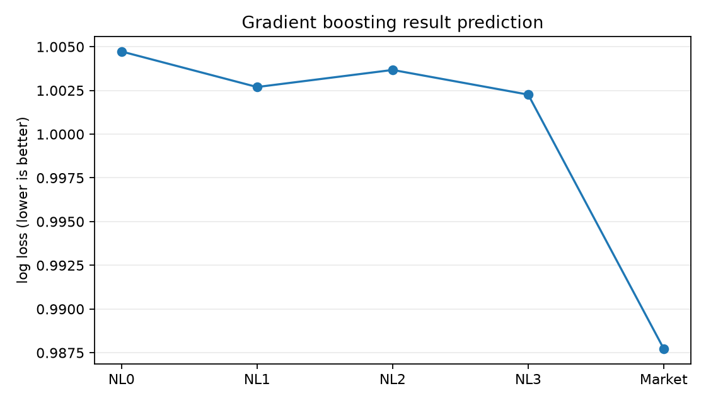

# 足球比赛分析

## 引言

### 任务与目标

任务是预测一场俱乐部比赛的全场赛果，分成主胜、平局、客胜，并给出三项概率。项目要比较的是：对给定的两队，近期状态和两队历史交锋哪一块更有用，以及它们和本场赔率是什么关系。

近期状态是每队最近五场、对手不限的比赛。历史交锋是这两队此前的全部直接交手。两者都在开赛前已知。联赛和 Elo 保持不变，比较的是在此之上多出来的那一块历史信息。

### 相关背景与已有工作

**本仓库未涉及。** 笔记本没有引用、概括或实现已有论文。这里不补写文献综述。

### 意义

**除任务本身外，本仓库未涉及。** 代码比较的是近期状态、历史交锋和赔率。它没有另写一段说明这个比较在预测任务之外为什么重要。

## 数据准备

只用 `Matches.csv` 和 `EloRatings.csv`。日期按文件记录使用。

1. 身份、日期或全场赛果缺失，或比分不是两支不同球队之间一致的非负结果时，删除该行。留下的比赛构成历史池，其中也包括后来因 Elo 或赔率不合格而未进入模型的比赛，因为它们的赛果仍然已知。
2. 已有 Elo 保留。缺失值用同一国家、同一球队、严格早于比赛日的最近评分填上，不设最长时间间隔。比赛当天和之后的评分不用。任一侧 Elo 仍然缺失的比赛退出建模样本，但留在历史池。
3. Form 按赛果重算，不用原始 Form 列。胜 3 分，平 1 分，负 0 分。某场只用严格更早的比赛。建模样本要求双方都有五场更早的比赛。
4. 三项普通赔率都必须是有限数且大于 1。先把赔率倒数归一化成概率，再保存相对平局的对数比。
5. 先建立候选指标，再筛选。近期是双方各自最近五场、对手不限，再做主队减客队。交锋是此前全部直接交手，换到本场主队视角。同一天先算特征，再写入当天赛果。

近期场均积分、净胜球和胜率是

$$
\mathrm{recent\_ppg\_diff}=\bar p_H-\bar p_A,\qquad
\bar p=\frac{1}{5}\sum_{i=1}^{5}\mathrm{pts}_i
$$

$$
\mathrm{recent\_gd\_diff}=\bar g_H-\bar g_A,\qquad
\mathrm{recent\_win\_rate\_diff}=\bar w_H-\bar w_A
$$

进球和失球先换到该队自己的视角，再相减：

$$
\mathrm{recent\_goals\_for\_diff}=\overline{\mathrm{GF}}_H-\overline{\mathrm{GF}}_A,\qquad
\mathrm{recent\_goals\_against\_diff}=\overline{\mathrm{GA}}_H-\overline{\mathrm{GA}}_A
$$

平局率平均和平局率差用同样的五场窗口，筛选后没有留下。

交锋场数 $n=\mathrm{h2h\_count}$。$n=0$ 时交锋各项为 0，且 $\mathrm{h2h\_missing}=1$。

$$
\mathrm{h2h\_ppg\_diff}=\frac{1}{n}\sum_{t=1}^{n}(\mathrm{pts}_{\mathrm{Home},t}-\mathrm{pts}_{\mathrm{Away},t})
$$

$$
\mathrm{h2h\_gd}=\frac{1}{n}\sum_{t=1}^{n}(\mathrm{GF}_{\mathrm{Home},t}-\mathrm{GA}_{\mathrm{Home},t})
$$

交锋胜率、进球、失球和平局率是同一批交手上的比例或场均。Elo 差和赔率输入是

$$
\mathrm{elo\_diff}=\mathrm{HomeElo}-\mathrm{AwayElo}
$$

$$
q_k=\frac{1/\mathrm{Odd}_k}{\sum_{j\in\{H,D,A\}}1/\mathrm{Odd}_j},\qquad
\mathrm{q\_log\_H\_D}=\log\frac{q_H}{q_D},\qquad
\mathrm{q\_log\_A\_D}=\log\frac{q_A}{q_D}
$$

筛选只用训练集。赛果分数 $y$ 为主胜 1、平局 0、客胜 $-1$。去掉 $|\rho(x,y)|<0.02$ 的列。同一组里 $|\rho(x_a,x_b)|\ge 0.95$ 时，只保留 $|\rho(\cdot,y)|$ 更大的那一列。$\rho$ 是 Spearman 相关系数。

`candidate_features.csv` 保存全部候选。`selected_features.csv` 保存通过筛选的列。半场比分不进入模型。射门、牌、角球和原始 `C_*` 列不使用。

<!-- data:start -->
### 样本量

| stage | matches |
| --- | --- |
| raw | 238858 |
| valid_history | 238854 |
| both_elo | 145903 |
| complete_last_5 | 143733 |
| valid_odds_cleaned | 141733 |

| split | matches | first_date | last_date | divisions |
| --- | --- | --- | --- | --- |
| train | 106288 | 2000-09-05 00:00:00 | 2020-12-31 00:00:00 | 29 |
| validation | 12598 | 2021-01-01 00:00:00 | 2022-12-31 00:00:00 | 29 |
| test | 11772 | 2023-01-01 00:00:00 | 2024-12-30 00:00:00 | 29 |
| excluded_after_2024 | 11075 | 2025-01-01 00:00:00 | 2026-09-03 00:00:00 | 22 |

近期留下：`recent_ppg_diff`、`recent_gd_diff`、`recent_win_rate_diff`、`recent_goals_for_diff`、`recent_goals_against_diff`。

交锋留下：`h2h_ppg_diff`、`h2h_gd`、`h2h_win_rate`、`h2h_goals_for`、`h2h_goals_against`。

模型在 2020 年及以前的比赛上拟合。惩罚项或树的棵数在 2021–2022 年选择，最终拟合使用截至 2022 年的比赛。评分使用 2023–2024 年。2025 年及以后不参与拟合和评分。数值标准化只在当前拟合集上学习。

这些测试年在更早的分析中已经查看过，因此下面的分数不是一次全新的盲测。建模样本要求有 Elo、完整的近五场和有效赔率，所以分数不能覆盖全部原始比赛。Elo 和赔率的原始记录时间没有对照其他来源核对。
<!-- data:end -->

## 探索性数据分析

代码实际做的探索是原始比赛表的缺失、Elo 补齐的场数，以及上面所说的、只在训练集上做的 Spearman 筛选。

原始比赛表中有缺失的列包括比赛时间（55.05%）、主队 Elo（37.24%）、客队 Elo（37.27%）、Form3 和 Form5 的四列（各 0.64%）、半场比分（22.85%），以及射门、犯规、角球和牌（约 46% 到 49%）。该表里的 `C_*` 列大约缺失 52.86%。去掉 4 行无效记录后，全场比分和赛果是齐的。高缺失的技术统计不用作特征。

Elo 补齐前，主队缺失 88,959 场，客队缺失 89,028 场。补齐后仍缺 78,336 个主队评分和 78,369 个客队评分。这些比赛留在历史池，并退出建模样本。重算 Form 后再去掉 2,170 场没有五场历史的比赛，赔率规则去掉 2,000 场。

**本仓库未涉及：** 进球或赔率的分布图、主场优势的正式检验，以及缺失、Elo 补齐和训练集 Spearman 筛选之外的探索。

## 学习方法

两族模型使用相同输入和相同时间划分。B 是联赛、Elo 差、交锋次数和没有交锋的标记。F 是筛选后的近期列。H 是筛选后的交锋列。Q 是两个赔率对数比。

逻辑回归是带 L2 惩罚的多项逻辑回归。惩罚候选是 0.01、0.1 和 1。赛果模型和赔率增量模型按验证集 Log Loss 选惩罚。拟合市场的模型按验证集 KL 选择。差距在 1e-8 以内时取较小的惩罚。联赛按训练期做独热编码。数值列在当前拟合集上标准化。每场比赛等权。

逻辑回归的嵌套设定是：

| 模型 | 输入 | 目标 |
| --- | --- | --- |
| M0–M3 | B，再加 F、H 或两者 | 全场赛果 |
| O0–O3 | 与 M0–M3 相同 | 赔率概率 |
| Qcal | 只有 Q | 全场赛果 |
| Q0–Q3 | Q + B，再加 F、H 或两者 | 全场赛果 |
| Market | 无 | 归一化赔率，不训练 |

梯度提升使用 `HistGradientBoostingClassifier`，学习率 0.08，每个叶节点最多 31 个，L2 为 1。树的棵数在训练期随机抽出的 10% 上早停决定，上限 200 棵，再按这个棵数在截至 2022 年的比赛上重训。NL0–NL3 与 M0–M3 对应。这一族不拟合市场，也不重复 Q 实验。

配对比较使用同一批比赛。报告的差值是左边模型的损失减去右边模型的损失，负数表示左边损失更低。每个测试年内按 28 天分块，块有放回抽样 1000 次。区间取 2.5% 和 97.5% 分位数。区间包含 0 时，不把差异当成稳定差别。区间不包含重新训练和特征筛选的不确定性。

## 结果

<!-- baseline:start -->
### 逻辑回归

测试集 11,772 场。M0 = B，M1 = B + 近期，M2 = B + 交锋，M3 = B + 两者。交锋次数已经在 B 里，下面比较的是交锋成绩。

| model | log_loss | accuracy |
| --- | --- | --- |
| M0 | 1.003156 | 0.502718 |
| M1 | 1.002627 | 0.501699 |
| M2 | 1.003151 | 0.503313 |
| M3 | 1.002606 | 0.501699 |
| Market | 0.987725 | 0.519878 |

Log Loss 之差是左边减去右边。负数表示左边更低。区间是 95% 分块自助区间。

| left | right | difference | ci_low | ci_high |
| --- | --- | --- | --- | --- |
| M1 | M0 | -0.000529 | -0.001245 | 0.000144 |
| M2 | M0 | -0.000005 | -0.000318 | 0.000308 |
| M1 | M2 | -0.000524 | -0.001185 | 0.000146 |
| M3 | M1 | -0.000021 | -0.000350 | 0.000297 |

M1 减 M2 的区间包含 0。逻辑回归没有显示筛选后的近期状态和历史交锋之间有稳定差距。

相对市场概率的 KL 只比较 M1 和 M2：差为 -0.000414，区间 [-0.000518, -0.000316]，不包含 0。M1 更接近市场。更接近市场本身并不表示对真实赛果有更稳定的改进。

拟合市场后，O1 相对赔率的 KL 比 O2 低 0.000635，区间 [-0.000801, -0.000487]，不包含 0。Qcal 只用赔率对数比，Log Loss 是 0.986260。Q0 加上 B，Q1、Q2、Q3 再分别加上近期、交锋和两者；这四者的 Log Loss 在 0.986350 到 0.986444 之间。

| left | right | difference | ci_low | ci_high |
| --- | --- | --- | --- | --- |
| Q1 | Q0 | -0.000036 | -0.000414 | 0.000360 |
| Q2 | Q0 | 0.000058 | -0.000046 | 0.000160 |
| Q3 | Q0 | 0.000014 | -0.000408 | 0.000422 |

赔率已经进入模型后，再加入近期或交锋，没有显示赛果 Log Loss 的稳定额外下降。

M3 的数值输入已标准化。Elo 差增加一个标准差时，主胜相对客胜的概率比变为原来的 2.223 倍。其余数值列的倍数在 0.885 到 1.086 之间。相关列会分担系数。

<!-- baseline:end -->

<!-- nonlinear:start -->
### 梯度提升

测试集与逻辑回归相同。NL0 = B，NL1 = B + 近期，NL2 = B + 交锋，NL3 = B + 两者。

| model | log_loss | accuracy |
| --- | --- | --- |
| NL0 | 1.004729 | 0.500510 |
| NL1 | 1.002695 | 0.500849 |
| NL2 | 1.003673 | 0.502973 |
| NL3 | 1.002262 | 0.503398 |
| Market | 0.987725 | 0.519878 |

| left | right | difference | ci_low | ci_high |
| --- | --- | --- | --- | --- |
| NL1 | NL0 | -0.002034 | -0.003264 | -0.000606 |
| NL2 | NL0 | -0.001056 | -0.002514 | 0.000303 |
| NL1 | NL2 | -0.000978 | -0.002418 | 0.000470 |
| NL3 | NL1 | -0.000433 | -0.001523 | 0.000639 |
| NL3 | NL2 | -0.001411 | -0.002766 | -0.000168 |

NL1 减 NL2 的 Log Loss 区间包含 0。这次梯度提升没有显示筛选后的近期状态和历史交锋之间有稳定差距。

<!-- nonlinear:end -->

## 结论

在 2023–2024 年的比赛上，逻辑回归分不出筛选后的近期状态和历史交锋。M1 减 M2 的 Log Loss 差是 -0.000524，95% 区间包含 0。梯度提升的同一比较，NL1 减 NL2，是 -0.000978，区间同样包含 0。

近期状态比历史交锋更接近赔率概率。M1 减 M2 的 KL 区间和 O1 减 O2 的 KL 区间都不包含 0，并且偏向近期。赔率已经进入逻辑回归后，再加入任一块历史，都没有带来赛果 Log Loss 的稳定进一步下降。

市场的 Log Loss 是 0.987725，仍低于 M0–M3 和 NL0–NL3。梯度提升从 NL0 到 NL1 有稳定的 Log Loss 下降。从 NL0 到 NL2 的下降区间包含 0。在近期之上再加交锋，NL3 相对 NL2 是稳定的，NL3 相对 NL1 不稳定。

这些陈述使用的是本仓库里筛选后的列和这两族模型。它们不能推广到全部原始比赛，而且测试年在这次比较之前已经被查看过。
